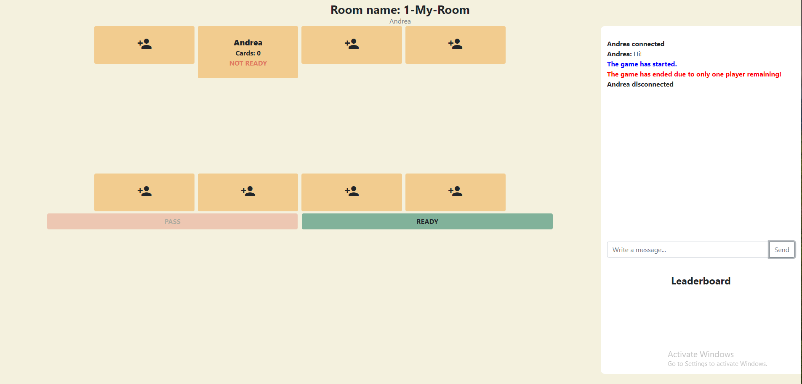
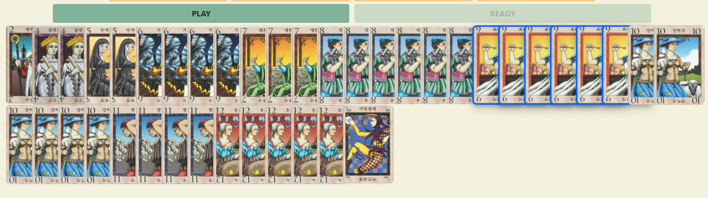

## The Great Dalmuti (Card game v2)

<h2>Main Features</h2>

- Game room function, chat, private rooms.
- Participants can be admitted as spectators according to the game start state of each room.
- Entry is not allowed in case of overcrowding.
- The game continues even if one user disconnect.
- Real cards and real rules!
- 3 differents language (English, Italian, Bulgarian).
- Responsive, mobile-friendly medieval-themed UI (Tailwind CSS).
- TypeScript client with strict type safety.
- Leaderboard for ranking that update after every match.
- Icon for every role plus pay taxes.

<a href="https://dalmuti-v1.herokuapp.com/"  style="font-weight:bold; font-size:30px;text-decoration:none;">Play for free!</a>






## Development

The frontend is TypeScript (`src/ts`) + Tailwind CSS (`src/css/tailwind.css`),
bundled with esbuild. The built files (`src/js/main.js`, `src/js/login.js`,
`src/css/app.css`) are committed, so `npm ci && npm start` is enough to run.

```bash
npm install
npm run build       # JS first, then CSS (Tailwind scans the built JS)
npm run typecheck   # tsc --noEmit
npm test            # node --test
npm start           # http://localhost:8080
```

Run `npm run build` after editing anything under `src/ts` or `src/css`.


Credits to the guy who started this project <a href="https://github.com/vlwkaos/simplified-dalmuti">vlwkaos/simplified-dalmuti</a>